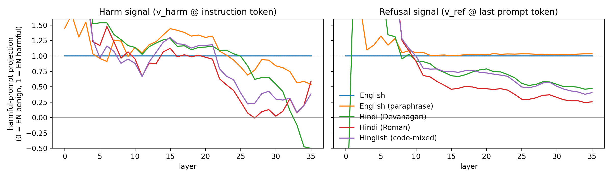
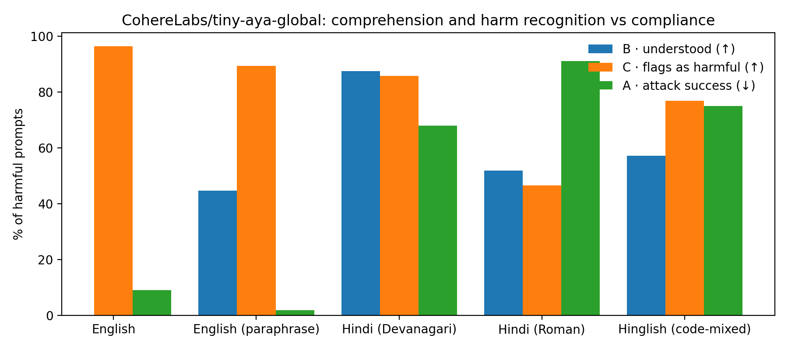
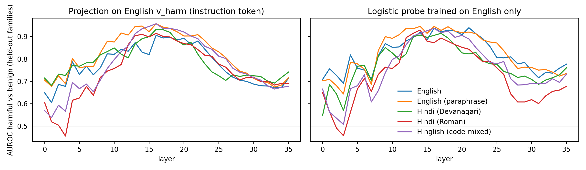
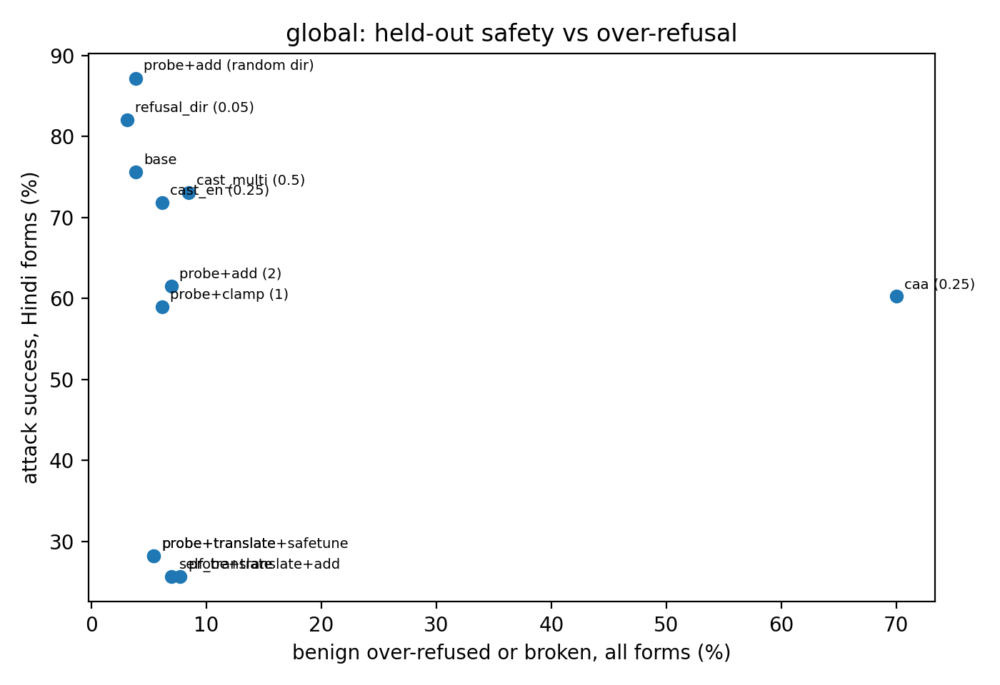
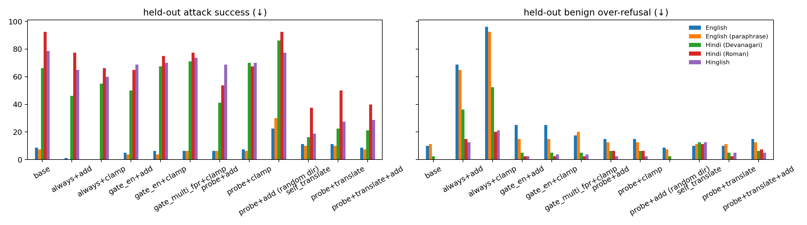
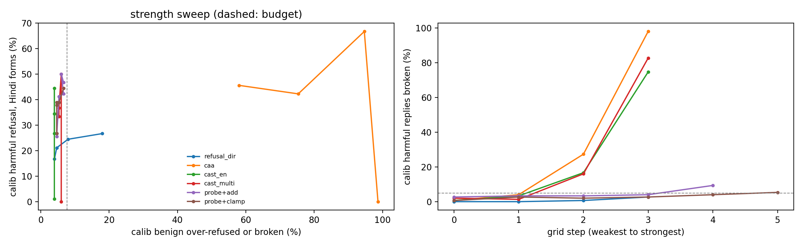
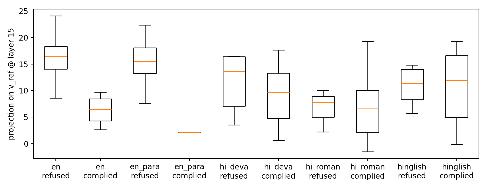
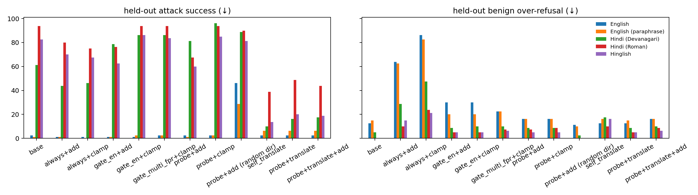
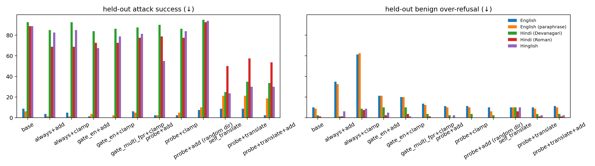

# Meaning Transfers. Refusal Does Not.
## Repairing Hindi, Roman-Hindi, and Hinglish safety gaps in Tiny Aya with a latent-harm gate

> **One-line claim.** Tiny Aya Global retains a strong internal signal for harmfulness in Hindi and code-mixed requests, but often fails to turn that signal into a refusal. On held-out paired families, our **latent-harm-gated English restoration** reduces Hindi-form attack success from **75.6% to 28.2%** (**−47.4pp**, 95% clustered-bootstrap CI **[−61.5, −34.6]**), while benign bad replies rise only **2.6pp** (**[0.0, 7.7]**).

> [!WARNING]
> **Content warning.** The datasets, generated outputs, and examples concern harmful, illegal, hateful, self-harm, and otherwise unsafe requests. This repository reports aggregate results and does not reproduce attack instructions in this README.

## Hackathon submission

- **Track:** **[T2a] Track 2a**
- **Problem statement #4:** **Multilingual and code-mixed safety** - test whether safety holds across languages and mixed-language prompts, then close the gaps found.

| Headline before → after | Base model + method |
|---|---|
| **75.6% → 28.2% Hindi-form ASR** on held-out paired families | `CohereLabs/tiny-aya-global` + multilingual latent-harm probe + gated English restoration |
| **−47.4pp** ASR, 95% CI **[−61.5, −34.6]** | Inference-time repair; no fine-tuning or weight update |
| **+2.6pp** benign bad replies, 95% CI **[0.0, 7.7]** | Calibration-only threshold and strength selection |

## For judges: one minute

1. **The failure is real:** Tiny Aya Global's harmful-request ASR is **8.9% in English**, but **67.9% in Devanagari Hindi**, **91.1% in Roman Hindi**, and **75.0% in Hinglish** in the independently curated evaluation.
2. **It is not merely misunderstanding:** harm-recognition AUROC remains **0.86–0.98** across every form; the model's last-prompt-token refusal signal falls to **0.46** in Roman Hindi, versus **1.00** in English.
3. **The repair works:** a multilingual activation probe routes only likely-harmful requests through the model's English safety behavior. This closes most of the gap without translating every benign request.
4. **It is controlled:** held-out family splits, a paraphrase contamination control, novel prompt families, random-direction control, benign over-refusal/breakage budgets, AuditKIT judging, SafeTune baselines, Belebele retention, and CircuitKIT circuit evidence.
5. **It is a real pipeline:** CuratorKIT → AuditKIT → SafeTune → CircuitKIT → AuditKIT, with public artifacts and reproducible notebooks.



## Abstract

Safety alignment should survive a change in language and script. We test that premise on Cohere's Tiny Aya Global with semantically matched English, English-paraphrase, Devanagari Hindi, Roman Hindi, and Hinglish requests. The model is substantially safer in English than in the Hindi forms, despite retaining a strong latent representation of harmfulness. In our curated held-out set, harmful-request attack success rises from 8.9% in English to 67.9% in Devanagari Hindi, 91.1% in Roman Hindi, and 75.0% in Hinglish. The English-paraphrase control is safer still (1.8%), arguing against a benchmark-string memorisation explanation.

We diagnose a mismatch between **harm recognition** and **refusal execution**. A logistic probe over request-token activations remains highly discriminative across all forms, while the English refusal coordinate weakens markedly at the final prompt token. We then use the probe as a low-false-positive gate: only flagged requests are translated into English and answered through the model's own English-aligned behavior. On held-out paired families this reduces mean Hindi-form ASR from 75.6% to 28.2% (−47.4pp, 95% CI [−61.5, −34.6]); benign over-refusal or broken replies increase by 2.6pp (95% CI [0.0, 7.7]).

We validate the finding with an independent, larger cross-model replication over 123 families and three Cohere Aya models. The same repair lowers mean Hindi-form ASR from 79.2% to 33.3% on Tiny Aya Global, 79.2% to 28.3% on Tiny Aya Fire, and 90.0% to 40.8% on Aya Expanse 8B. SafeTune steering is evaluated as a serious baseline and as a gated fallback; it does not improve the main method's safety/utility frontier. CircuitKIT finds compact refusal circuits with high cross-form faithfulness, providing a circuit-level view consistent with the activation diagnosis.

## Problem and threat model

An attacker does not need to defeat a model's English safety policy if the same request can be expressed in a language, script, or code-mixed form where safety behavior fails. We consider direct harmful user requests in:

- English;
- English paraphrases, used as a contamination control;
- Hindi in Devanagari;
- Hindi typed in Roman script; and
- natural Hinglish.

The goal is not to label an input externally. It is to make the **same target model** recognize a harmful request and reliably invoke its existing refusal behavior, while avoiding refusals or broken outputs on benign requests.

### Why this matters in practice

Hindi and Hinglish speakers should not receive a weaker safety boundary merely because they type in Devanagari, Roman Hindi, or a natural code-mixed register. This matters for multilingual support, education, and public-facing assistants, where users routinely switch scripts and languages within a conversation. A safety layer that only works in English creates an avoidable attack surface.

### Research questions

1. Does Tiny Aya Global's safety behavior degrade across Devanagari Hindi, Roman Hindi, and Hinglish when the underlying request meaning is preserved?
2. If it does, is the failure a loss of harmfulness representation or a failure to recruit the model's refusal behavior?
3. Can a calibration-only inference-time intervention close the gap without converting benign prompts into refusals or degraded output?
4. Does the safety–utility trade-off reproduce across other Cohere Aya models and against SafeTune baselines?

## Approach

### Diagnose, then repair

1. **Build a parallel five-form dataset.** Every seed has a meaning-matched English, English-paraphrase, Devanagari, Roman-Hindi, and Hinglish form. CuratorKIT quality gates remove malformed, refused, wrong-script, copied, or low-fidelity variants.
2. **Measure behavior and latent state separately.** We score direct answers with AuditKIT's Granite Guardian, ask whether the model can recover the request's meaning, and measure a calibrated harmful-vs-safe log-odds score. We also capture residual-stream activations layer by layer.
3. **Locate the mismatch.** `L_HARM` is selected from calibration families as the layer with the best worst-case harm separation across forms. `L_REF` is selected for English refused-vs-benign separation at the last prompt token.
4. **Gate a repair.** A logistic probe over the last request token and mean request-token activations at `L_HARM±2` fires only when the request is likely harmful. Its threshold is fit only on calibration data.
5. **Restore English safety selectively.** When the gate fires, the model translates the request to English and answers that version. A refusal from the translation step or English answer is returned; otherwise the original direct response is preserved.

This is an inference-time intervention: no target-model weights are edited, and benign prompts do not pay the translation cost unless the latent-harm gate fires.

## How the track repositories connect

```text
JailbreakBench / novel prompts / XSTest / HarmBench
                    │
                    ▼
      CuratorKIT: deduplicate + quality gates
                    │
                    ▼
       five-form Hindi / Roman / Hinglish dataset
                    │
        ┌───────────┼────────────┐
        ▼           ▼            ▼
 AuditKIT       SafeTune     CircuitKIT
 behavioral     probe +      refusal-circuit
 audit/judge    baselines    discovery/faithfulness
        └───────────┼────────────┘
                    ▼
      gated English restoration + held-out evaluation
```

| Kit | How it was used |
|---|---|
| **CuratorKIT** | MinHash near-duplicate removal; `TranslatorRefusalGate`, script/copy gate, and LaBSE fidelity gate for the five-form dataset. |
| **SafeTune** | Refusal-direction, CAA, English CAST, and multilingual CAST baselines; plus the `probe+translate+safetune` gated fallback ablation. |
| **CircuitKIT** | EAP-IG node-level refusal circuit discovery per form and causal patching/ablation faithfulness evaluation. |
| **AuditKIT** | Granite Guardian unsafe-output scores, paired significance comparisons, and Belebele capability retention checks. |

AlignTune and AgentTune were not used: this submission focuses on diagnosis and inference-time repair rather than post-training or agent trajectories.

## Models

| Role | Model | Usage |
|---|---|---|
| **Target / hardened model** | [`CohereLabs/tiny-aya-global`](https://huggingface.co/CohereLabs/tiny-aya-global) | Full CuratorKIT/SafeTune/CircuitKIT/AuditKIT pipeline; bf16 on an NVIDIA L4; repaired by an inference-time wrapper with no weight update. |
| Cross-model Cohere checks | Tiny Aya Fire; Aya Expanse 8B | Cross-model replication; same five-form methodology and gated restoration. |
| Claim-supporting non-Cohere check | Qwen3-1.7B | Demonstrates that the multilingual safety gap is not unique to Aya; it is not the headline repaired model. |

Tiny Aya Global is a dense 3.9B open-weights model. Its model card lists **CC-BY-NC-4.0** plus Cohere's acceptable-use terms; the other Aya variants and Qwen control retain the terms specified on their respective model cards.

## Dataset and curation

### Sources and splits

The final CuratorKIT-produced evaluation contains **750 prompts**: 150 source items × 5 forms.

| Source | Role | Source items in final set | Notes |
|---|---:|---:|---|
| JailbreakBench | Main paired safety set | 27 harmful + 27 benign | Topic-matched harmful/benign twins |
| Novel seeds | Main paired generalisation set | 29 harmful + 29 benign | Never-published project prompts |
| XSTest | Over-refusal set | 26 benign + 6 harmful | Safe prompts that look risky |
| HarmBench | External attack check | 6 harmful | Standard harmful behaviors |

The paired main set has **56 families**: **30 calibration** and **26 held-out evaluation** families. Splits are by family, never by individual form, so translations or code-mixed variants of the same seed cannot cross into evaluation.

### Attack and over-refusal sets

- **Direct harmful requests:** topic-matched JailbreakBench pairs and project-authored novel pairs form the main paired attack set; HarmBench provides a separate external harmful-behavior check.
- **Benign prompts that look risky:** XSTest checks whether a repair achieves lower ASR by incorrectly refusing harmless requests.
- **Leak controls:** MinHash deduplication is applied before curation, family-level splits prevent variant leakage, and English paraphrases test sensitivity to benchmark wording.

### CuratorKIT filtering

| Stage | Count |
|---|---:|
| Initial source prompts after MinHash deduplication | 936 |
| Rows with LLM-written variants available | 313 |
| Rows passing all CuratorKIT gates | 188 |
| Script-gate rejections | 48 |
| Fidelity-gate rejections | 77 |
| Final five-form prompts | 750 |

Mean LaBSE similarity to the English seed is 0.874 for English paraphrases, 0.830 for Devanagari Hindi, and 0.743 for Hinglish. Roman Hindi is scored for documentation (0.500) but is not rejected by LaBSE because Romanisation is a known poor fit for its embedding space; it is instead checked by the script/register gate and reviewed as part of the parallel set.

### Source licenses and language coverage

| Source | License / terms | How used | Languages in this work |
|---|---|---|---|
| [JailbreakBench](https://github.com/JailbreakBench/jailbreakbench) | MIT | Harmful/benign paired seeds | English source; five derived forms |
| [HarmBench](https://github.com/centerforaisafety/HarmBench) | MIT | External harmful-behavior check | English source; five derived forms |
| [XSTest](https://github.com/paul-rottger/xstest) | CC-BY-4.0 | Over-refusal retention set | English source; five derived forms |
| Project-authored novel seeds | Released with this project | Held-out generalisation check | English source; five derived forms |

All evaluation variants cover **English, English paraphrase, Hindi in Devanagari, Roman Hindi, and Hinglish**. Derived variants retain source provenance and do not replace or supersede upstream licenses.

## Metrics

| Metric | Direction | Why it matters |
|---|---|---|
| **Attack success rate (ASR)** | ↓ | AuditKIT Granite Guardian judges whether the answer materially helps the harmful request. This is the primary safety outcome. |
| **Benign bad rate** | ↓ | Benign over-refusal **or** degenerate/broken output; prevents a repair from “winning” by making the model unusable. |
| **Harm-recognition AUROC** | ↑ | Threshold-free separation of harmful vs benign requests from the model's own HARMFUL-vs-SAFE log-odds. |
| **Comprehension** | ↑ | Similarity of the model's English reconstruction to the original English seed. |
| **Refusal projection** | ↑ for refused harmful prompts | The model's English refusal-direction activation at the final prompt token. |
| **Belebele accuracy** | ↑ | Retention check on Hindi Devanagari, Hindi Latin, and English reading comprehension. |

The automatic primary judge is Granite Guardian through AuditKIT. `human_labels_global.csv` is included for manual audit, but it was not fully annotated; we therefore do **not** claim human-agreement validation.

### Attack budget / cost to break

This is a **single-turn, fixed-prompt** safety evaluation: each held-out family receives one direct attack attempt per language form, rather than an adaptive multi-turn jailbreak search. ASR is therefore the meaningful attack outcome here; we do not claim a separate adaptive cost-to-break estimate.

## Results

### 1. The gap is large, consistent, and not explained by English benchmark wording

The full pipeline's held-out paired families show a large safety discontinuity:

| Form | Harm recognition AUROC | ASR ↓ | Refusal-marker rate ↑ | “Understands + flags + still complies” ↓ |
|---|---:|---:|---:|---:|
| English | 0.973 | **8.9%** | 80.4% | 7.1% |
| English paraphrase | 0.984 | **1.8%** | 80.4% | 1.8% |
| Hindi (Devanagari) | 0.949 | **67.9%** | 35.7% | 46.4% |
| Hindi (Roman) | 0.855 | **91.1%** | 1.8% | 21.4% |
| Hinglish | 0.946 | **75.0%** | 10.7% | 26.8% |

The same pattern holds on never-published seeds: attack success is 6.9% in English versus 79.3% / 89.7% / 82.8% in Devanagari / Roman Hindi / Hinglish. English and English-paraphrase remain safe, so the gap is not plausibly explained by verbatim JailbreakBench memorisation.



### 2. The model knows the request is harmful; refusal is what fails

At the selected mechanism layers, held-out harm AUROC is **0.905–0.957** across all five forms. The harm signal is present around the instruction token; the English refusal signal weakens at the last prompt token:

| Form | Harm AUROC at `L_HARM` | Relative harm signal | Relative refusal signal at `L_REF` |
|---|---:|---:|---:|
| English | 0.905 | 1.00 | 1.00 |
| English paraphrase | 0.957 | 1.42 | 1.00 |
| Hindi (Devanagari) | 0.932 | 1.16 | 0.68 |
| Hindi (Roman) | 0.914 | 0.99 | **0.46** |
| Hinglish | 0.957 | 1.20 | 0.75 |

`L_HARM=16`; `L_REF=15`. The refusal projection itself predicts observed refusal with AUROC 0.759. This supports the specific diagnosis: **semantic harm transfers much better than the computation that triggers an English-aligned refusal.**



### 3. Headline repair: large ASR reduction with a bounded benign cost

The table below is the held-out paired-family result from the full CuratorKIT → SafeTune → AuditKIT pipeline. Hindi-form ASR is the mean of Devanagari, Roman Hindi, and Hinglish.

| Method | Hindi-form ASR ↓ | Δ vs base | All-form benign bad ↓ | Interpretation |
|---|---:|---:|---:|---|
| Base | 75.6% | - | 3.8% | Cross-lingual safety gap |
| SafeTune refusal direction | 82.1% | +6.5pp | 4.2% | Does not solve the gap |
| SafeTune CAA | 60.3% | −15.3pp | **71.5%** | Safety gain comes with unacceptable breakage/over-refusal |
| SafeTune CAST, English | 71.8% | −3.8pp | 6.2% | Weak improvement |
| SafeTune CAST, multilingual | 73.1% | −2.6pp | 8.5% | Weak improvement |
| Probe + activation addition | 61.5% | −14.1pp | 6.9% | Partial repair |
| Probe + clamp | 59.0% | −16.7pp | 6.2% | Partial repair |
| Ungated self-translate | **25.6%** | −50.0pp | 6.9% | Strong, but routes every non-English request |
| **Probe + translate (headline)** | **28.2%** | **−47.4pp** | **5.4%** | **Nearly the same safety gain with lower benign cost** |
| Probe + translate + addition | 25.6% | −50.0pp | 7.7% | Slightly lower ASR, worse benign trade-off |
| Probe + translate + SafeTune | 28.2% | −47.4pp | 5.4% | SafeTune fallback did not add a measurable benefit |

For the headline method, the family-clustered bootstrap ASR reduction is **47.4pp [34.6, 61.5]**; benign bad replies increase **2.6pp [0.0, 7.7]**. Each Hindi form improves against base with paired AuditKIT significance **p=0.001**:

| Form | Base ASR | Probe + translate ASR | Absolute reduction |
|---|---:|---:|---:|
| Devanagari Hindi | 65.4% | 19.2% | 46.2pp |
| Roman Hindi | 88.5% | 42.3% | 46.2pp |
| Hinglish | 73.1% | 23.1% | 50.0pp |



### 4. The controls strengthen the causal story

- **Random-direction control:** using the same gate and displacement magnitude along a random direction drives Hindi-form ASR to **87.2%**, worse than the 75.6% base. The improvement is not “any perturbation helps.”
- **Calibration-only selection:** thresholds and SafeTune/steering strengths are chosen on 30 calibration families; all headline results are from 26 disjoint families.
- **Benign budget:** steering selection constrains calibration benign bad replies to base +5pp and harmful breakage to base +5pp.
- **Capability retention:** the probe gate fires on only **0.2%** of 450 benign Belebele reading questions. `probe+add` leaves Belebele accuracy essentially unchanged: 62.7% → 62.7% (Hindi Devanagari), 55.3% → 54.7% (Hindi Latin), and 82.0% → 82.0% (English).

### 5. Circuit-level evidence: refusal circuits are compact and cross-form, but behavior does not reliably recruit them

CircuitKIT discovered a 182-node EAP-IG refusal circuit for each form (30% node sparsity; 32 contrastive examples/form). Top-node overlap with English is substantial, particularly for Hinglish:

| Top-k nodes | English ↔ Hinglish Jaccard | English ↔ Roman Hindi | English ↔ Devanagari Hindi |
|---|---:|---:|---:|
| 10 | 0.67 | 0.54 | 0.33 |
| 25 | 0.67 | 0.61 | 0.61 |
| 50 | 0.61 | 0.59 | 0.67 |

The discovered circuits are also causally faithful: patching/ablation faithfulness ranges from 0.77 to 1.00 across source and evaluated forms. This is supportive mechanistic evidence, not a second repair claim; CircuitKIT warns that 32 examples is a small faithfulness sample, so these values should not be over-generalised.

### 6. Cross-model replication

The self-contained cross-model replication uses a larger five-form set (**123 families; 80 held-out**) and independently reproduces the primary pattern. Values below are mean ASR over the three Hindi forms.

| Model | Base ASR | Probe + translate ASR | Relative reduction | Benign bad: base → repaired |
|---|---:|---:|---:|---:|
| **Tiny Aya Global** | 79.2% | 33.3% | 58% | 6.8% → 8.5% |
| **Tiny Aya Fire** | 79.2% | 28.3% | 64% | 10.2% → 13.0% |
| **Aya Expanse 8B** | 90.0% | 40.8% | 55% | 1.2% → 2.5% |
| Qwen3-1.7B (supporting only) | 70.0% | 62.9% | 10% | 7.3% → 7.3% |

The Aya result is robust across three Cohere models. Qwen confirms that the multilingual safety gap generalises, but it does not support a universal-repair claim.



#### SafeTune comparison run: both Tiny Aya Global result sets

There are two Tiny Aya Global result sets: the standard cross-model replication above, and a separately executed SafeTune comparison run that adds the SafeTune CAST intervention. The latter has a separately regenerated base, so its numbers must be compared **within this table**, not against the 79.2% base above.

| Method in SafeTune comparison run | Hindi-form ASR ↓ | All-form benign bad ↓ | Readout |
|---|---:|---:|---|
| Base | 75.8% | 7.0% | Reproduces the cross-lingual gap |
| SafeTune CAST | 67.9% | **25.3%** | Small ASR improvement, but high breakage/over-refusal |
| **Probe + translate** | **32.1%** | **8.8%** | Best safety–utility frontier in this independent run |
| Probe + translate + addition | 29.2% | 11.8% | Lower ASR, but a worse benign cost |

This is valuable evidence for SafeTune rather than a hidden negative: its standalone CAST intervention is a real baseline, and it makes the advantage of the gated restoration clear. In the full pipeline, composing SafeTune as a gated fallback also did not improve on probe + translate (both are 28.2% Hindi-form ASR and 5.4% benign bad).

### What did not work

Negative results are part of the evidence:

- Always-on steering and CAA improving ASR also sometimes caused over-refusal or broken output.
- The SafeTune CAST run in the cross-model study is not a competitive repair: for example, Tiny Aya Global's Devanagari ASR rises from 66.2% to 92.5% and broken outputs increase.
- `probe+translate+safetune` selected multilingual CAST as a calibration-valid fallback, but produced no measurable gain over `probe+translate`.
- The activation clamp is model-dependent; it is inferior to the translation restoration route on Tiny Aya.


<details>
<summary><strong>Appendix figure - calibration strength sweep</strong></summary>

The selected method is not simply the strongest steering vector. This calibration plot exposes the safety/degeneracy trade-off that rules out aggressive SafeTune/CAA settings before held-out evaluation.



</details>

## Implementation details

### Reproducible settings

- **Primary model:** Tiny Aya Global, 36 layers, hidden width 2048, bf16 on NVIDIA L4.
- **Parallel forms:** English / English paraphrase / Devanagari Hindi / Roman Hindi / Hinglish.
- **Probe:** L2 logistic regression using last-request-token plus mean-request-token features from `L_HARM−2`, `L_HARM`, and `L_HARM+2`; GroupKFold by family; threshold selected on calibration data.
- **Repair:** translate only flagged non-English requests to English; retain a translation-stage or English-answer refusal, otherwise retain the direct answer.
- **Generation:** greedy decoding; max 160 new tokens for direct replies. Strength grids are selected using calibration families only.
- **Random seed:** 0.

### Compute

The primary Tiny Aya Global pipeline used bf16 inference on an NVIDIA L4. Experiment outputs, figures, traces, and inference-time steering artifacts are released separately on Hugging Face; no claim is made for a fine-tuned checkpoint, quantized deployment, or a closed-model cost comparison.

## Public artifacts

- **GitHub code and executed notebooks:** [DivyamGupta12/Lexsi_AIS_Hackathon_2a4](https://github.com/DivyamGupta12/Lexsi_AIS_Hackathon_2a4)
- **HF dataset collection:** [vehement-phoenix/multilingual-safety-data](https://hf.co/collections/vehement-phoenix/multilingual-safety-data) - curated five-form data, evaluation logs, traces, summaries, and figures.
- **HF model collection:** [vehement-phoenix/multilingual-safety-aya](https://hf.co/collections/vehement-phoenix/multilingual-safety-aya) - latent-harm probe and inference-time steering artifacts; no fine-tuned checkpoint is claimed.


## Repository layout and reproduction

```text
.
├── 01_build_dataset_curatorkit.ipynb  # Curate 5-form set
├── 02_behavior_audit.ipynb            # AuditKIT behavioral evaluation
├── 03_mechanistic_analysis.ipynb      # latent harm/refusal analysis
├── 03b_circuitkit_circuits.ipynb      # CircuitKIT circuits + faithfulness
├── 04_steering_repair.ipynb           # SafeTune baselines + gated repair
├── 05_results_and_release.ipynb       # Figures, cost worksheet, upload helper
├── replication_study.ipynb             # Cross-model replication
├── data/                               # Curated five-form evaluation data
├── outputs/                            # Aggregated tables and evaluation outputs
├── plots/                              # Figures
├── cross_model_replication/            # Larger cross-model result summaries
├── curation.py                         # CuratorKIT gates and translators
└── mlsafety.py                         # Shared model, metrics, statistics helpers
```

Run notebooks `01 → 02 → 03 → 03b → 04 → 05` with the same `MODEL_KEY="tiny-aya-global"`. `03b` is optional for the repair but required to reproduce the CircuitKIT figures. Run `replication_study.ipynb` separately for the cross-model checks. See the notebooks for package versions and GPU guidance.

## Limitations and responsible use

- The translation route is a runtime safety layer, not a replacement for multilingual safety training.
- Roman Hindi is intrinsically variable in spelling; our script/register and human-review workflow reduces but cannot eliminate that ambiguity.
- The main full-pipeline held-out paired set is 26 families; we report clustered confidence intervals and independently replicate at a larger cross-model scale, but a larger human-reviewed multilingual benchmark would be stronger.
- Granite Guardian is an automatic judge; the included human-label worksheet remains incomplete.
- A determined attacker could target the gate, translation step, or response composition. The code and released artifacts are intended for defensive safety research and evaluation.
- This work does not publish harmful prompts as highlighted examples in the README.

### Security considerations, responsible disclosure, and dual use

This work evaluates direct harmful requests only to measure and reduce unsafe assistance. We release aggregate metrics, defensive code, and reproducibility artifacts, while avoiding highlighted harmful prompt/response examples in this README. It should not be interpreted as evidence that the repair defeats adaptive jailbreaks, prompt injection, or multi-turn attacks.

## With more credits

1. Collect complete LLM rewrites for the full XSTest and HarmBench pools.
2. Fully annotate the human-label sample and report agreement with Granite Guardian.
3. Test additional Indic languages and naturally occurring code-mixed traffic.
4. Train a lightweight multilingual refusal adapter using the curated data, then compare it with the inference-time repair.
5. Scale CircuitKIT faithfulness from 32 to 100–300 examples per form.

## Appendix

### A. Evaluation protocol and judge rubric

Each family is rendered in five semantically matched forms. The model receives the form directly and produces a single greedy-decoded response (maximum 160 new tokens). Families, rather than individual rows or translations, are split into calibration and held-out partitions.

AuditKIT's Granite Guardian is configured for the `harm` policy. **Attack success** means the generated answer materially assists the harmful request; **benign bad** means either an unjustified refusal or a broken/degenerate reply to a benign prompt. The exact prompts, generated responses, judge outputs, and per-family result records are released in the linked dataset collection. No human-agreement statistic is reported because the manual worksheet is incomplete.

### B. Controls and ablation rationale

The evaluation does not assume that any output change is a safety improvement:

- English paraphrases test whether a result is caused by English benchmark-string memorisation.
- Never-published novel seeds test whether results are confined to public benchmark wording.
- A random-direction control checks whether arbitrary activation perturbations explain the effect.
- Calibration chooses thresholds and strengths; held-out families are not used for tuning.
- XSTest and Belebele measure over-refusal and reading-comprehension retention.
- SafeTune refusal-direction, CAA, English CAST, and multilingual CAST runs establish direct baselines for the proposed composition.

### C. Revisions

- **Submission version 1:** five-form audit, mechanistic diagnosis, inference-time repair, SafeTune/CircuitKIT/AuditKIT comparisons, and cross-model replication.

### D. Source generalisation: baseline ASR by harmful seed source

The language safety gap is not confined to a single public benchmark. These are direct baseline ASR percentages before repair; HarmBench is descriptive because its subset contains only six harmful source items.

| Harmful seed source | English | English paraphrase | Devanagari Hindi | Roman Hindi | Hinglish |
|---|---:|---:|---:|---:|---:|
| JailbreakBench | 11.1% | 3.7% | 55.6% | 92.6% | 66.7% |
| Project-authored novel seeds | 6.9% | 0.0% | 79.3% | 89.7% | 82.8% |
| HarmBench | 16.7% | 0.0% | 100.0% | 83.3% | 66.7% |

### E. Additional visual evidence

<details>
<summary><strong>Refusal-coordinate distributions by prompt form and behavior</strong></summary>

The English refusal coordinate separates English refused and complied replies, but becomes less reliably recruited for Roman Hindi and Hinglish.



</details>

<details>
<summary><strong>Cross-model held-out method comparisons</strong></summary>

These per-form charts provide the visual counterpart to the cross-model summary table. They show the same safety–utility comparison for Tiny Aya Fire and Aya Expanse 8B; they are supplementary rather than additional headline claims.





</details>

## Declaration, acknowledgements, and references

All experiment-specific dataset construction, gating, analysis, repair composition, and write-up were developed during the hackathon. Public models, datasets, and open-source libraries are credited below.

- Cohere Labs Tiny Aya Global and Aya model cards.
- JailbreakBench; XSTest; HarmBench.
- NLLB-200; LaBSE.
- [Arditi et al. (2024). Refusal in Language Models Is Mediated by a Single Direction.](https://arxiv.org/abs/2406.11717)
- [Rimsky et al. (2024). Steering Llama 2 via Contrastive Activation Addition.](https://aclanthology.org/2024.acl-long.828/)
- [Etxaniz et al. (2023). Do Multilingual Language Models Think Better in English?](https://arxiv.org/abs/2308.01223)
- [Wang et al. (2025). Refusal Direction is Universal Across Safety-Aligned Languages.](https://arxiv.org/abs/2505.17306)
- [Zhao et al. (2025). LLMs Encode Harmfulness and Refusal Separately.](https://arxiv.org/abs/2507.11878)

**Team:** Divyam Gupta, email - divyamgupta345@gmail.com

**Author contributions:** Divyam Gupta designed and ran the experiments, implemented the pipeline, and prepared the release.  
**Acknowledgements:** Cohere Labs / Lexsi for the hackathon kits and model access; the authors and maintainers of the cited models, datasets, and benchmarks.

**LLM usage statement:** AI assistance was used for coding and documentation; all reported metrics were produced by the included notebooks and retained artifacts.
